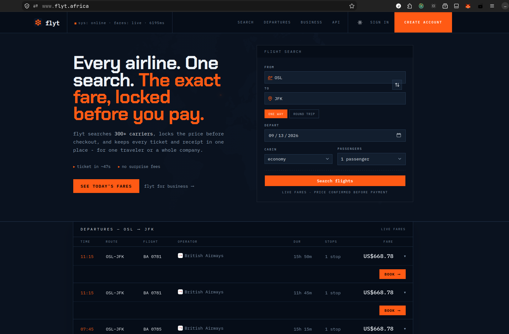

<div align="center">

# flyt

**Every airline. One search. The exact fare, locked before you pay.**

[flyt.africa](https://www.flyt.africa) &nbsp;·&nbsp; Search 300+ carriers, hold the price through checkout, and keep every ticket and receipt in one place.




</div>

---

## What this is

A production travel booking platform. A traveller searches real inventory through [Duffel](https://duffel.com), pays by M-Pesa or card through [Pesapal](https://pesapal.com), and gets an issued ticket with a PDF itinerary — for themselves or for a whole company.

The interesting parts are not the search box. They are the three places where money, suppliers and failure meet:

**Payment and fulfilment are settled separately, and reconciled idempotently.** The checkout is snapshotted before the customer is charged, then replayed against Duffel when Pesapal's IPN confirms. flyt pays the airline the raw fare from its Duffel balance while charging the traveller a marked-up total, so the two ledgers never have to agree in real time — only eventually, and exactly once.

**A Duffel refund credits flyt, not the traveller.** Cancelling an order returns money to flyt's own Duffel balance; getting the customer their money back is an independent movement down the rail they actually paid on. Pesapal also refunds M-Pesa only in full, so partial mobile-money refunds are routed to a staff queue rather than silently failing.

**Schema changes gate the release.** Migrations run once per deploy rather than once per instance, so a migration that fails leaves the previous version serving instead of rolling out code its schema cannot support.

## Architecture

```
                    Next.js 16 · React 19 · TanStack Query
                                    │
                                    ▼
        ┌──────────────────── FastAPI ────────────────────┐
        │  auth · flights · bookings · payments · stays   │
        │  cars · admin · concierge · webhooks · health   │
        └───┬───────────────┬───────────────┬─────────────┘
            │               │               │
            ▼               ▼               ▼
      PostgreSQL         Redis           Vercel Queues
      (Neon)             cache +         4 topics · 8 event types
      SQLModel           rate limits          │
      Alembic                                 ▼
                                        subscriber function
                                        email · notifications
                                        refunds

   Suppliers   Duffel (air · stays · cars) · Pesapal · Resend · OpenAI
```

The API publishes events fire-and-forget and serves every request without waiting on them; what stops when delivery stalls is background work, not booking.

### Stack

| Layer | |
|---|---|
| **Frontend** | Next.js 16, React 19, TanStack Query, Tailwind v4, GSAP, zod |
| **Backend** | Python 3.12, FastAPI, SQLModel, Alembic, fastapi-guard |
| **Data** | PostgreSQL 17 (Neon in deployed environments), Redis |
| **AI** | pydantic-ai concierge, streamed over the Vercel AI SDK protocol |
| **Infrastructure** | Vercel (functions, queues, cron), Neon, Docker for local |
| **Observability** | Vercel observability (logs, metrics, traces) |

## Repository layout

```
backend/      FastAPI service — routers, crud, models, schemas,
              external_services (Duffel, Pesapal, Uber, Resend, OpenAI),
              queues (subscriber), workers (handlers), alembic (16 revisions)
frontend/     Next.js app
docs/         decision records, including where the backend runs and why
```

## Running it locally

**Backend** — everything it needs comes up in Compose:

```bash
cd backend
cp .env.example .env        # fill in the required values; see backend/config.py
docker compose up -d --build
```

The API is on `:8000`. Secrets come from `.env`, or from Doppler when `DOPPLER_TOKEN` is set — the entrypoint detects it rather than assuming it.

**Frontend**:

```bash
cd frontend
npm install
npm run dev                 # :3000
```

## Tests

```bash
cd backend && uv sync --frozen
backend/.venv/bin/pytest backend/tests
```

**339 tests**, no database and no network required — the suite runs against in-memory SQLite with dependency overrides, and every supplier is stubbed. It needs only a Redis to be reachable, because fastapi-guard opens its connection during app startup.

## Deployment

Both halves run on **Vercel**: the Next.js app, and the FastAPI backend as a
Python function (`backend.main:app`, configured in `vercel.json` and the root
`pyproject.toml`). Data lives in **Neon** Postgres, which no platform move has
touched. Deploys come from git — a preview per pull request, production on
merge, rollback by promoting an earlier deployment.

It did not start there. AWS EC2 and EKS came first, then two attempts at
Cloudflare Workers, each abandoned for a reason worth reading before anyone
proposes a fourth platform — see [docs/backend-platform.md](docs/backend-platform.md).

## Status

Shipped and live: flight search, booking, payment, ticketing, refunds, PDF itineraries, admin dashboard with RBAC, pricing and discount codes, and the AI concierge.

In progress: **stays and cars** are implemented against Duffel but awaiting product entitlement on the account, and an **Uber Guest Rides** airport pickup — bundled with the flight it belongs to — is awaiting API approval. Both are gated so an unconfigured provider is simply absent rather than a runtime failure.
